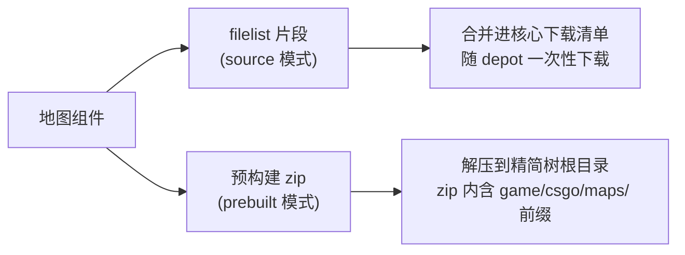

# CS2 精简服务端地图组件复刻指南

> 本文档讲解 CS2 精简服务端「地图组件」的结构、来源与三种获取方式，属于 [cs2-slim-replica](https://github.com/cyqmq/cs2-slim-replica) 项目文档。
> 配套阅读：[《纯手动复刻指南》](CS2_SLIM_GUIDE.md)（服务端本体构建）、[《精简树全解析》](CS2_SLIM_TREE_GUIDE.md)（目录结构）。

---

## 一、为什么地图要单独成组件

- 精简树核心包只内置一张默认竞技地图 **de_dust2**（约 250MB），其余 8 张官方竞技地图以「**地图组件**」形式按需添加。
- CS2 的每张地图是一个独立的 **`game/csgo/maps/de_xxx.vpk`**（约 150~430MB），内部包含该地图的完整内容：世界几何、材质、粒子、导航网格（nav）、人机（bots）数据等，**不需要额外的 loose 文件**。
- 地图的 `maps/prefabs/`（预置实体）已包含在核心下载清单中，选配地图只需下载地图 VPK 本身。
- 地图 VPK 不属于 `pak01_*.vpk` 编号体系，引擎按地图路径直接加载，因此可以独立下载/分发，不影响「精简树无编号包」的原则。

当前 9 张竞技地图及体积：

| 地图 | VPK 大小（约） | 预构建 zip 大小（约） | 默认 |
|------|------------|----------------|------|
| de_dust2 | 250 MB | 核心包内置 | ✅ 必须 |
| de_mirage | 168 MB | 155 MB | 选配 |
| de_inferno | 432 MB | 398 MB | 选配 |
| de_ancient | 387 MB | 364 MB | 选配 |
| de_anubis | 257 MB | 236 MB | 选配 |
| de_cache | 295 MB | 271 MB | 选配 |
| de_nuke | 236 MB | 212 MB | 选配 |
| de_overpass | 312 MB | 288 MB | 选配 |
| de_train | 364 MB | 328 MB | 选配 |
| de_vertigo | 182 MB | 165 MB | 选配 |

---

## 二、地图组件结构

### 2.1 注册表 registry/maps.json（单一事实源）

主仓库 [`registry/maps.json`](../registry/maps.json) 是地图组件的注册表，字段含义：

| 字段 | 含义 |
|------|------|
| `required` | `true` = 核心地图，始终加载（当前仅 de_dust2） |
| `filelist` | 追加到核心下载清单的路径片段（= 地图 VPK 精确路径） |
| `prebuilt_url` | 预构建 zip 地址（GitHub Release，可为空） |

示例（de_mirage）：

```json
"de_mirage": {
  "required": false,
  "name": "Mirage",
  "filelist": ["game/csgo/maps/de_mirage.vpk"],
  "prebuilt_url": "https://github.com/cyqmq/cs2-slim-maps/releases/latest/download/de_mirage.zip"
}
```

### 2.2 地图组件仓库 cs2-slim-maps

每个地图一个目录：

```text
cs2-slim-maps/
├── de_mirage/
│   ├── filelist.txt     # 追加到 filelist_2347770.txt 的下载片段（一行路径）
│   └── metadata.json    # 元数据（depot、大小、更新时间）
├── de_inferno/
│   └── ...
└── build_map_zips.py    # 把 depot 中的地图 VPK 打包成预构建 zip
```

`metadata.json` 示例：

```json
{
  "name": "Mirage",
  "updated": "2026-10-06",
  "size_mb": 250,
  "required": false,
  "filelist": ["game/csgo/maps/de_mirage.vpk"],
  "depot": 2347770
}
```

### 2.3 两种分发形态



| 形态 | 内容 | 用途 |
|------|------|------|
| filelist 片段 | `game/csgo/maps/de_xxx.vpk` 一行文本 | source 模式，随核心 depot 一起下载 |
| 预构建 zip | 含 `game/csgo/maps/de_xxx.vpk` | prebuilt 模式，直接解压到精简树根目录 |

---

## 三、地图来源与原理

- 地图 VPK 位于 **depot 2347770**（共享内容）的 `game/csgo/maps/` 目录，与核心资产同库。
- 加载优先级：地图 VPK 属于 `game VPK` 层级，但**不经过 `pak01_dir.vpk` 索引**，引擎按 `+map de_xxx` 直接读取 `maps/de_xxx.vpk`。
- 因此精简树移走全部 `pak01_*.vpk` 后，保留 `maps/de_dust2.vpk` 依然可以正常加载地图。

---

## 四、获取地图组件的三种方式

### 方式 A：source 模式（随核心一起构建，推荐）

在 `slim.yaml` 或命令行指定 `CS2_MAPS`：

```yaml
platform: linux
maps:
  - de_dust2
  - de_mirage
  - de_inferno
features: []
```

```bash
python cs2slim.py download --config slim.yaml   # 核心 + 地图 VPK 一起下载
python cs2slim.py extract  --config slim.yaml
python cs2slim.py build    --config slim.yaml   # 地图 VPK 落到 game/csgo/maps/
```

`cs2slim.py` 会把 `maps.json` 中对应地图的 `filelist` 合并进核心下载清单，**一次性下载**，无需单独处理地图。

### 方式 B：prebuilt 模式（已有预构建包，最快）

```bash
# 一键脚本（Linux，先 export 再 curl|bash）
export CS2_MODE=prebuilt CS2_MAPS=de_dust2,de_mirage
curl -fsSL https://raw.githubusercontent.com/cyqmq/cs2-slim-replica/main/scripts/get-cs2slim.sh | bash

# CLI 等价
python cs2slim.py prebuilt --config slim.yaml
```

`cs2slim.py` 会从 `releases/latest/download/de_mirage.zip` 下载并解压到精简树根目录。

也可以手动拼装（适合已有精简树）：

```bash
curl -fsSL -o de_mirage.zip https://github.com/cyqmq/cs2-slim-maps/releases/latest/download/de_mirage.zip
unzip -o de_mirage.zip -d <精简树根目录>     # zip 内已含 game/csgo/maps/ 前缀
```

### 方式 C：纯手动复刻（制作预构建包）

当需要为某张地图制作预构建包（或验证原理）时：

**1. 用 DepotDownloader 精确下载地图 VPK**（filelist 只含一行）：

```text
game/csgo/maps/de_ancient.vpk
```

```bash
./DepotDownloader -app 730 -depot 2347770 \
  -filelist map_ancient.txt -dir cs2_depot -os linux -osarch 64
```

**2. 打包成预构建 zip**（路径前缀 `game/csgo/maps/`）：

```bash
python build_map_zips.py <depot>/game/csgo/maps <output_dir> de_ancient
```

产物：`de_ancient.zip`，内含 `game/csgo/maps/de_ancient.vpk`。

**3. 发布与注册**：
- 上传 zip 到 `cs2-slim-maps` Release（`gh release upload v1.0.0 de_ancient.zip --clobber`）
- 在 `registry/maps.json` 为该地图填写 `prebuilt_url`
- 更新 `de_ancient/metadata.json` 的 `updated` 日期

---

## 五、注册表与 CLI 校验行为

`cs2slim.py` 对地图组件有严格校验，避免「选了等于白选」：

| 场景 | 行为 |
|------|------|
| 未知地图组件 | `错误: 未知地图组件 de_xxx，请检查 registry/maps.json`（报错退出） |
| prebuilt 模式选中无 `prebuilt_url` 的地图 | 报错退出，提示改用 source 模式 |
| `CS2_MAPS` 未包含 de_dust2 | `resolve_maps()` 自动在开头插入 de_dust2（核心地图兜底） |
| de_dust2 在 prebuilt 模式 | 核心包内置，不额外下载 |

> 当前 9 张竞技地图均已有预构建包，prebuilt 模式可全部选择。

---

## 六、踩坑与注意事项

1. **prefabs 不能丢**：`maps/prefabs/` 由核心清单提供，若精简树缺少该目录，地图 Spawn 后会回退 Idle（看起来像秒退）。
2. **zip 解压位置**：预构建 zip 内含 `game/csgo/maps/` 前缀，必须解压到精简树**根目录**（不是 `game/csgo/` 内）。
3. **地图是 VPK 不是散文件**：不要把地图 VPK 解压成 loose files；`csgo/` 下保留 `pak01_*.vpk` 会破坏精简树。
4. **注册表一致性**：`maps.json` 与 `cs2-slim-maps` 仓库的 `metadata.json` 应保持同步；修改后运行 `python generate_data.py`（生成器数据源）。
5. **版本字段**：`maps.json` 的 `version` 与各地图 `metadata.json` 的 `updated` 记录更新时间，便于追溯。
6. **编码**：`maps.json` 为 UTF-8 编码 JSON，`build_combined_filelist` 读取时使用 `utf-8-sig` 兼容 BOM。

---

## 七、参考链接

| 资源 | 链接 |
|------|------|
| 地图组件仓库 | https://github.com/cyqmq/cs2-slim-maps |
| 地图注册表 | [`registry/maps.json`](../registry/maps.json) |
| 地图打包脚本 | [`cs2-slim-maps/build_map_zips.py`](https://github.com/cyqmq/cs2-slim-maps/blob/main/build_map_zips.py) |
| CS2 SteamDB depots（2347770） | https://steamdb.info/app/730/depots/ |
| 纯手动复刻指南 | [`CS2_SLIM_GUIDE.md`](CS2_SLIM_GUIDE.md) |
| 精简树全解析 | [`CS2_SLIM_TREE_GUIDE.md`](CS2_SLIM_TREE_GUIDE.md) |