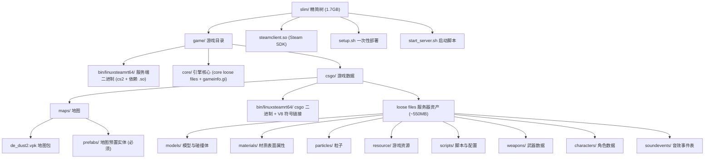
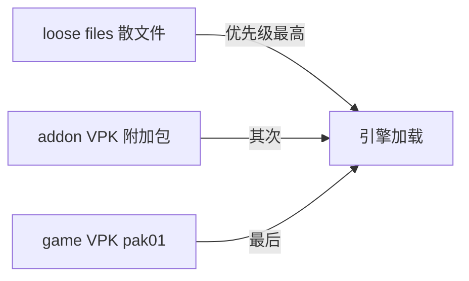

# CS2 精简树（Slim Tree）全解析

> 本文档用「结构图 + 工具 + 原理」三步讲清 CS2 精简服务端的目录结构、制作工具与底层机制。内容为通用技术知识，不依赖任何特定精简项目。
>
> 属于 [cs2-slim-replica](https://github.com/cyqmq/cs2-slim-replica) 项目文档；详细手动构建命令见 [《纯手动复刻指南》](CS2_SLIM_GUIDE.md)。

---

## 一、什么是精简树

精简树是 CS2 专用服务器被裁剪后的**完整可运行目录**。原版约 72.3GB，精简后约 **1.7GB（Linux）/ 1.9GB（Windows）**（解压后），只保留服务器运行必需的二进制、地图和数据资产，删掉纯客户端纹理/音频/UI。

精简树由「DepotDownloader 下载 + VPK 提取工具提取散文件 + 手动/脚本组装」得到，产物是一个 `slim/`（Linux）或 `slim-win/`（Windows）目录，可直接启动 CS2 服务器。

---

## 二、精简树结构图

### 2.1 总览



### 2.2 真实目录树（Linux 版）

```text
slim/
├── game/
│   ├── bin/linuxsteamrt64/          # 服务端主程序与运行库
│   │   ├── cs2                       # 服务端二进制（启动入口）
│   │   └── libv8*.so ...             # V8 引擎等依赖库
│   ├── core/                         # 引擎核心（Source 2 共享内容）
│   │   ├── gameinfo.gi
│   │   ├── gameinfo_branchspecific.gi
│   │   └── ... (core loose files)
│   └── csgo/
│       ├── bin/linuxsteamrt64/
│       │   ├── cs2                   # csgo 层二进制
│       │   └── libv8*.so -> ../../bin/linuxsteamrt64/...  # V8 符号链接
│       ├── cfg/                      # 服务器配置
│       ├── maps/
│       │   ├── de_dust2.vpk         # 地图 VPK（唯一保留的 game VPK）
│       │   └── prefabs/             # 地图预置实体（缺失会导致回退 Idle）
│       ├── models/                  # ← loose files（从编号包提取）
│       ├── materials/
│       ├── particles/
│       ├── resource/
│       ├── scripts/
│       ├── weapons/
│       ├── characters/
│       ├── soundevents/
│       ├── gameinfo.gi              # 已移除 pak 挂载
│       └── steam.inf
├── steamclient.so                   # 64 位 Steam SDK（链接到 ~/.steam/sdk64/）
├── setup.sh                         # 一次性部署（steamclient + V8 链接 + 权限）
└── start_server.sh                  # 启动脚本（-insecure + 端口/网络参数）
```

> 关键特征：`csgo/` 下**没有任何 `pak01_*.vpk`**——这是精简树体积小的根本原因。

---

## 三、使用的工具

| 工具 | 作用 | 获取 |
|------|------|------|
| **DepotDownloader** | 按 filelist 从 Steam depot 精确下载 CS2 服务端文件 | GitHub `SteamRE/DepotDownloader` Releases |
| **ValveResourceFormat（Source2Viewer-CLI）** | 解析/提取 VPK 中的资源为散文件 | https://s2v.app（命令行版 `Source2Viewer-CLI`） |
| **（可选）ValvePython/vpk** | Python 方式浏览/提取 VPK | `pip install vpk` |
| **SteamDB** | 查询 CS2 depot ID、manifest、文件清单 | https://steamdb.info/app/730/depots/ |
| **自写组装脚本（可选）** | 把二进制 + loose files + 地图 + prefabs 复制成精简树 | 按需编写（`cp`/`rsync` 即可） |

> 制作精简树只需要上面的通用工具 + 手动组装步骤，详细流程见 [《纯手动复刻指南》](CS2_SLIM_GUIDE.md)。

---

## 四、精简原理

### 4.1 为什么原版这么大

CS2 服务端体积主要来自 `game/csgo/pak01_dir.vpk` + **506 个编号数据块**（约 53GB）。其中：

- **44GB 纯客户端纹理**（`.vtex_c`）
- **4.4GB 音频**（`.vsnd_c`）
- 其余为全景图 / 贴纸 / UI / shaders

这些是给玩家客户端渲染用的。**服务器进程不渲染画面、不播放声音**，完全不需要它们。

### 4.2 为什么不能直接删

VPK 是"目录索引 + 编号数据块"结构：

```text
pak01_dir.vpk   ← 目录索引（所有文件路径、CRC、所在包号、偏移）
pak01_000.vpk   ← 数据块（真实文件内容）
pak01_001.vpk
...
pak01_505.vpk
```

`gameinfo.gi` 会自动挂载 `csgo/` 下所有 `pak*_dir.vpk`。一旦挂载 `pak01_dir.vpk`，引擎就索引全部编号包；启动时读任何资产都会去对应编号包里找，缺包即 `FATAL ERROR`。所以**不能只留几个包删掉其它**。

### 4.3 核心手法：利用 Source 2 文件系统优先级



加载优先级：**`loose files > addon VPK > game VPK`**。

因此精简步骤是：

1. **只下载**含服务端必需内容的编号包（约 7GB，含 `pak01_dir.vpk` 及关键编号块 + 地图 + prefabs + 二进制）
2. **提取精华**：用 Source2Viewer-CLI 把服务器需要的文件从编号包中提取为 loose files（约 550MB / 1.9 万个文件）
   - 排除：`textures/`（纹理）、`sounds/`（音频）、`panorama/`、`stickers/`、`patches/`、`sprays/`、`shaders/`
   - 保留：`models/`、`materials/`、`particles/`、`resource/`、`scripts/`、`weapons/`、`characters/`、`soundevents/` 等
3. **移走全部 `pak01_*.vpk`**，让引擎搜不到编号包，只能从 loose files 加载
4. **保留地图 VPK + prefabs + 服务端二进制**，启动即用

### 4.4 两个必须保留的东西

| 必须项 | 原因 |
|------|------|
| `maps/prefabs/` | 缺失会导致地图 Spawn 后 `GameServerSteamAPIDeactivated`，服务器回退 Idle（看起来像秒退） |
| `steamclient.so`（64 位） | 新版 SteamCMD 已不带，需从 Steam SDK 包获取并链接到 `~/.steam/sdk64/` |

### 4.5 启动方式

精简树以 `-insecure` 模式运行（无 VAC，社区服务器常规做法）：

```bash
./game/bin/linuxsteamrt64/cs2 \
  -dedicated +map de_dust2 +hostname "SlimServer" \
  -maxplayers 12 -ip 0.0.0.0 -port 27015 \
  -insecure -condebug +game_type 0 +game_mode 0 \
  +sv_pure 0 +sv_cheats 1
```

---

## 五、怎么获得精简树

通用手动流程（详细命令见 [《纯手动复刻指南》](CS2_SLIM_GUIDE.md)）：

1. 用 DepotDownloader 下载 depot 2347770（共享内容）+ 2347773/2347771（平台二进制）
2. 用 Source2Viewer-CLI 从 `pak01_dir.vpk` 提取服务器必需资产为 loose files
3. 手动把「二进制 + loose files + 地图 VPK + prefabs + cfg」组装成 `slim/`
4. 部署 `steamclient.so`、V8 符号链接、`-insecure` 启动

---

## 六、参考链接

| 资源 | 链接 |
|------|------|
| DepotDownloader | https://github.com/SteamRE/DepotDownloader |
| ValveResourceFormat / Source2Viewer-CLI | https://github.com/ValveResourceFormat/ValveResourceFormat |
| Source2Viewer-CLI 命令行文档 | https://s2v.app/ValveResourceFormat/guides/command-line.html |
| CS2 SteamDB depots | https://steamdb.info/app/730/depots/ |